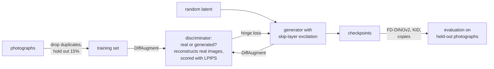

# gantrain

gantrain trains a [FastGAN](https://arxiv.org/abs/2101.04775) on your own photographs, on one GPU, up to 3072×2048, and checks that it makes new images rather than copies. It trained [the models](https://huggingface.co/collections/gustavecortal/ganlive-6ac56a61006a78b3e1ff5406) that [ganlive](https://github.com/gustavecortal/ganlive) plays live.

<p align="center">
  <a href="https://huggingface.co/gustavecortal/ganlive-amber"></a>
</p>

## Quick start

Requires Python 3.10 to 3.13 and [uv](https://docs.astral.sh/uv/getting-started/installation/). Runs on Windows, macOS and Linux, with an NVIDIA, AMD, Intel or Apple GPU, or the CPU.

### 1. Install

```bash
git clone https://github.com/gustavecortal/gantrain.git
cd gantrain
uv venv --python 3.12
```

Install [PyTorch and torchvision for your hardware](https://pytorch.org/get-started/locally/) with `uv pip install`, then install gantrain:

```bash
uv pip install -e .
```

### 2. Curate your photographs

```bash
uv run --no-sync gantrain curate path/to/photos --out data/curated
```

Exact and near-identical shots are dropped, and 15% are held out for evaluation. A few hundred photographs are enough to start. A few thousand give more variety.

### 3. Train

```bash
uv run --no-sync gantrain train --data data/curated --out runs/mine --resolution 512 --width 768
```

Samples appear in `runs/mine/samples` as training goes, and checkpoints in `runs/mine/checkpoints`. Stop and resume at any time with `--resume runs/mine/checkpoints/<step>.pt`.

### 4. Play it live

Convert a checkpoint with [ganlive](https://github.com/gustavecortal/ganlive#bring-your-own-gan) to play it in the browser, by hand or from drums.

## Commands

| Command | What it does |
|---|---|
| `device` | Show the GPU and the precision training will use |
| `curate` | Scan photographs, drop duplicates, split train and test |
| `train` | Train a FastGAN from scratch or resume a run |
| `sample` | Write images from a checkpoint |
| `video` | Render a looping latent interpolation |
| `diversity` | Track how varied the samples are across a run (Vendi score) |
| `evaluate` | Score generated images against held-out ones: FD-DINOv2, KID, CMMD, precision, recall, copies |

Run `gantrain <command> --help` for every option.

## How it works



gantrain trains [FastGAN](https://arxiv.org/abs/2101.04775), a GAN designed for small image sets. The generator has skip-layer excitation. The discriminator also reconstructs the real images it judges, scored with [LPIPS](https://github.com/richzhang/PerceptualSimilarity), and [DiffAugment](https://arxiv.org/abs/2006.10738) keeps it from memorising a few hundred images. Training uses bf16 where the GPU supports it, otherwise fp32.

The [published models](https://huggingface.co/collections/gustavecortal/ganlive-6ac56a61006a78b3e1ff5406), lichen at 3072×2048 and amber at 1536×1024, were trained on one $350 Intel Arc A770. amber's settings are a good starting point for your own run:

```bash
uv run --no-sync gantrain train --data data/curated --out runs/amber --resolution 1024 --width 1536 --batch-size 16 --iterations 80000 --lr 3e-4 --lr-warmup 2000 --jacobian-weight 1.5 --compile
```

`--jacobian-weight` keeps the latent space smooth, which makes the model nicer to play live. `--compile` makes each step about 1.3× faster at batch 16 and uses a third less GPU memory, after a one-off build of up to half an hour. It needs a C compiler.

## License

[MIT](LICENSE).
